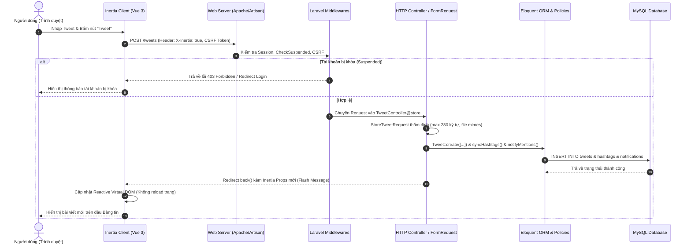
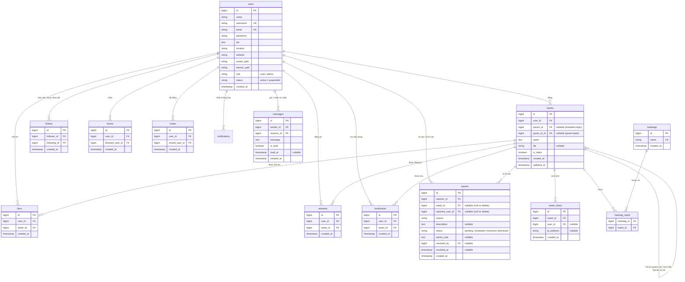

# BÁO CÁO GIỚI THIỆU DỰ ÁN MÃ NGUỒN MỞ: TWITTER / X CLONE

---

## 0. Trang bìa

```text
========================================================================================
                      BỘ GIÁO DỤC VÀ ĐÀO TẠO
               TRƯỜNG ĐẠI HỌC: <!-- TODO: điền Tên trường / Khoa -->
                       KHOA CÔNG NGHỆ THÔNG TIN

                    BÁO CÁO MÔN HỌC
           PHÁT TRIỂN PHẦN MỀM MÃ NGUỒN MỞ (OPEN SOURCE SOFTWARE DEVELOPMENT)

              ĐỀ TÀI: XÂY DỰNG MẠNG XÃ HỘI MICROBLOGGING (TWITTER / X CLONE)
               DỰA TRÊN HỆ SINH THÁI LARAVEL VÀ INERTIA.JS + VUE 3
========================================================================================
```

* **Tên dự án:** Twitter / X Clone Platform
* **Slogan:** *Nền tảng chia sẻ thông điệp ngắn thời gian thực, hiện đại, bảo mật và tinh gọn xây dựng trên hệ sinh thái mã nguồn mở Laravel & Vue 3.*
* **Huy hiệu công nghệ (Badges):**
  
  -FF2D20?style=flat-square&logo=laravel&logoColor=white)
  
  
  
  
  
  

* **Thông tin nhóm và học phần:**
  * **Học phần:** Phát triển phần mềm mã nguồn mở
  * **Mã lớp học phần:** `<!-- TODO: điền Mã lớp học phần -->`
  * **Giảng viên hướng dẫn:** `<!-- TODO: điền Họ và tên Giảng viên hướng dẫn -->`
  * **Nhóm thực hiện:** `<!-- TODO: điền Tên nhóm / Số thứ tự nhóm -->`
  * **Kho lưu trữ mã nguồn (Repository):** `<!-- TODO: điền URL Git Repository (GitHub/GitLab) -->`
  * **Thời gian hoàn thành:** Tháng 10/2026

---

## 1. Tổng quan dự án

### 1.1 Dự án là gì và giải quyết vấn đề gì?
Dự án **Twitter / X Clone** là một ứng dụng web mạng xã hội dạng microblogging (tiểu blog) cho phép người dùng đăng tải các mẩu tin ngắn, đính kèm tệp đa phương tiện (hình ảnh, video ngắn), phản hồi, trích dẫn, tương tác cảm xúc, kết nối mạng lưới bạn bè thông qua cơ chế theo dõi (Follow), nhắn tin trực tiếp và trao đổi thông tin theo thời gian thực.

Dự án giải quyết bài toán:
1. **Chia sẻ và lan tỏa thông tin nhanh chóng:** Cho phép người dùng cập nhật trạng thái ngắn gọn (giới hạn 280 ký tự), gắn thẻ xu hướng (`#hashtag`) và nhắc tên bạn bè (`@mention`).
2. **Trải nghiệm ứng dụng đơn trang mượt mà (SPA - Single Page Application):** Loại bỏ hoàn toàn hiện tượng nhấp nháy trắng màn hình khi tải lại trang truyền thống nhờ kết hợp công nghệ Inertia.js và Vue 3.
3. **An toàn và kiểm soát nội dung:** Cung cấp cơ chế phân quyền hai cấp độ (Người dùng - Quản trị viên), bộ công cụ báo cáo bài viết vi phạm, khóa tài khoản tự động và kiểm duyệt nội dung độc hại.

### 1.2 Lý do chọn đề tài, mục tiêu và phạm vi
* **Lý do chọn đề tài:** Mạng xã hội phong cách Twitter/X là một trong những mô hình kinh điển và phức tạp trong kỹ thuật phần mềm mạng. Ứng dụng này đòi hỏi việc xử lý các mối quan hệ nhiều-nhiều (Many-to-Many) phức tạp (Follow, Like, Retweet, Bookmark, Mention, Direct Message), quản lý luồng cấp tin tức (Newsfeed Timeline) với độ trễ thấp, và bảo vệ nghiêm ngặt quyền riêng tư người dùng.
* **Mục tiêu:**
  * Vận dụng toàn diện các nguyên lý cốt lõi của môn học **Phát triển phần mềm mã nguồn mở**: kế thừa, đóng góp, tuân thủ giấy phép phần mềm nguồn mở (FOSS), tổ chức cấu trúc mã nguồn theo chuẩn công nghiệp (PSR-12).
  * Chuyển đổi và nâng cấp toàn diện từ một đồ án tiền nhiệm viết bằng PHP thuần không cấu trúc sang một khung kiến trúc tiêu chuẩn công nghiệp hiện đại sử dụng **Laravel Monolith + Inertia.js**.
  * Xây dựng bộ kiểm thử tự động (Automated Testing) với 67 ca kiểm thử đảm bảo độ tin cậy và không hồi quy (regression) của toàn bộ tính năng.
* **Phạm vi dự án:**
  * Triển khai đầy đủ tính năng người dùng: Xác thực, Đăng bài, Sửa bài, Xóa bài, Tương tác (Like/Retweet/Quote/Bookmark/View Count), Theo dõi, Chặn/Tắt tiếng, Tìm kiếm từ khóa và Hashtag, Tin nhắn trực tiếp 1-1, Thông báo hoạt động.
  * Triển khai cổng Quản trị viên (Admin Portal) độc lập: Thống kê tổng quan hệ thống, kiểm duyệt báo cáo vi phạm, xử lý gỡ bài viết và khóa tài khoản vi phạm.

### 1.3 Điểm nổi bật so với bản PHP thuần ban đầu
Dự án được kế thừa và tái cấu trúc từ mã nguồn tiền nhiệm PHP thuần (`twitter-php-mysql`). Bảng sau đây làm nổi bật những bước chuyển đổi quan trọng:

* **Từ mã nguồn phân tán sang kiến trúc MVC chuẩn mực:** Bản cũ trộn lẫn mã PHP, câu lệnh SQL PDO và thẻ HTML trong từng file kịch bản; bản mới phân tách rành mạch thành Models (Eloquent), Views (Vue 3 Components), Controllers (Laravel HTTP Controllers) và Middleware kiểm soát luồng.
* **Bảo mật mặc định (Secure by Default):** Tự động bảo vệ chống lại các lỗ hổng OWASP hàng đầu: CSRF Protection với Token trên toàn bộ form, SQL Injection Protection bằng cơ chế Prepared Statements của Eloquent, XSS Protection thông qua cơ chế Auto-escaping của Vue Template và Sanitization.
* **Trải nghiệm người dùng vượt bậc:** Bản cũ yêu cầu reload toàn trang sau mỗi nút bấm Like hoặc Đăng tweet. Bản mới giữ trạng thái trang mượt mà (Inertia SPA), cập nhật DOM ảo tức thì, có bộ đếm ký tự sống động và xem trước đa phương tiện trước khi tải lên.
* **Bổ sung quản trị và kiểm thử chuyên nghiệp:** Bổ sung trung tâm quản trị (Admin Dashboard) với biểu đồ số liệu, quy trình giải quyết Report vi phạm và tích hợp bộ kiểm thử PHPUnit toàn diện với 67 ca kiểm thử tự động.

---

## 2. Tính năng chính

Hệ thống được module hóa thành các phân hệ nghiệp vụ độc lập, minh bạch và chặt chẽ:

| STT | Phân hệ / Tính năng | Mô tả ngắn | Cách hoạt động & Quy tắc nghiệp vụ | File chính phụ trách |
|---|---|---|---|---|
| 1 | **Xác thực & Bảo mật tài khoản** | Đăng ký, Đăng nhập, Đăng xuất, Đổi mật khẩu, Khôi phục mật khẩu | Người dùng có thể đăng nhập bằng **Email** hoặc **Username**. Hệ thống kiểm tra trạng thái tài khoản qua Middleware `check.suspended`; tài khoản bị khóa (`suspended`) sẽ bị từ chối đăng nhập kèm thông báo vi phạm. Mật khẩu được băm bằng thuật toán Bcrypt. | [AuthenticatedSessionController.php](file:///c:/xampp/htdocs/twitter-clone/app/Http/Controllers/Auth/AuthenticatedSessionController.php)<br>[LoginRequest.php](file:///c:/xampp/htdocs/twitter-clone/app/Http/Requests/Auth/LoginRequest.php)<br>[CheckSuspended.php](file:///c:/xampp/htdocs/twitter-clone/app/Http/Middleware/CheckSuspended.php) |
| 2 | **Hồ sơ cá nhân (Profile)** | Xem và tùy biến hồ sơ người dùng | Cho phép cập nhật Tên hiển thị, Tiểu sử (Bio), Vị trí, Website, Ảnh đại diện (Avatar) và Ảnh bìa (Banner). Hỗ trợ upload ảnh lưu trữ tại `storage/app/public` hoặc nhập URL trực tiếp. Hiển thị ngày tham gia, số lượng Following / Followers. | [UserProfileController.php](file:///c:/xampp/htdocs/twitter-clone/app/Http/Controllers/UserProfileController.php)<br>[Show.vue](file:///c:/xampp/htdocs/twitter-clone/resources/js/Pages/Profile/Show.vue)<br>[EditProfileModal.vue](file:///c:/xampp/htdocs/twitter-clone/resources/js/Components/EditProfileModal.vue) |
| 3 | **Đăng tải bài viết (Create Tweet)** | Soạn thảo và phát hành bài viết mới | Giới hạn tối đa **280 ký tự**. Hỗ trợ đính kèm 01 tệp đa phương tiện: ảnh (jpeg, png, jpg, gif) hoặc video (mp4) dung lượng tối đa 50MB. Tự động phát hiện và trích xuất `#hashtag` lưu vào bảng riêng và gửi thông báo nhắc tên khi có `@mention`. | [TweetController.php](file:///c:/xampp/htdocs/twitter-clone/app/Http/Controllers/TweetController.php)<br>[StoreTweetRequest.php](file:///c:/xampp/htdocs/twitter-clone/app/Http/Requests/StoreTweetRequest.php)<br>[Tweet.php](file:///c:/xampp/htdocs/twitter-clone/app/Models/Tweet.php) |
| 4 | **Chỉnh sửa & Xóa bài viết** | Biên tập nội dung hoặc xóa tweet | **Chỉnh sửa:** Chủ sở hữu có thể sửa nội dung bài viết và thay thế/xóa ảnh đính kèm mà không mất tương tác cũ; hashtag được đồng bộ lại tự động. **Xóa:** Áp dụng `TweetPolicy`, chỉ tác giả bài viết hoặc tài khoản có role `admin` mới có quyền xóa. Xóa bài tự động dọn dẹp liên kết báo cáo (chuyển `tweet_id` thành `NULL`). | [TweetController.php](file:///c:/xampp/htdocs/twitter-clone/app/Http/Controllers/TweetController.php)<br>[TweetPolicy.php](file:///c:/xampp/htdocs/twitter-clone/app/Policies/TweetPolicy.php)<br>[Tweet.vue](file:///c:/xampp/htdocs/twitter-clone/resources/js/Components/Tweet.vue) |
| 5 | **Phản hồi dạng chuỗi (Thread / Reply)** | Trả lời tweet của người khác hoặc của chính mình | Thiết lập quan hệ phân cấp cây thông qua cột `parent_id`. Cho phép người dùng theo dõi mạch hội thoại liền mạch tại trang chi tiết bài viết. Đếm tổng số reply động. Tự động gửi thông báo phản hồi cho chủ bài viết gốc. | [TweetController.php](file:///c:/xampp/htdocs/twitter-clone/app/Http/Controllers/TweetController.php)<br>[Show.vue (Tweet)](file:///c:/xampp/htdocs/twitter-clone/resources/js/Pages/Tweet/Show.vue) |
| 6 | **Trích dẫn bài viết (Quote Tweet)** | Bình luận kèm bài viết dẫn nguồn | Sử dụng cột `quote_of_id` tham chiếu đến tweet gốc. Khung trích dẫn hiển thị thu nhỏ tweet nguồn bên dưới nội dung bình luận của người trích dẫn. Tự động gửi thông báo trích dẫn cho chủ tweet gốc. | [TweetController.php](file:///c:/xampp/htdocs/twitter-clone/app/Http/Controllers/TweetController.php)<br>[Tweet.vue](file:///c:/xampp/htdocs/twitter-clone/resources/js/Components/Tweet.vue) |
| 7 | **Tương tác cảm xúc (Like / Favorite)** | Thả tim / Bỏ thả tim bài viết | Cơ chế đảo trạng thái (Toggle) sử dụng quan hệ nhiều-nhiều trên bảng `likes`. Chống spam bằng `firstOrCreate` / `delete`. Tự động tạo bản ghi thông báo trong bảng `notifications` khi đối tượng like không phải chính chủ tweet. | [LikeController.php](file:///c:/xampp/htdocs/twitter-clone/app/Http/Controllers/LikeController.php)<br>[Like.php](file:///c:/xampp/htdocs/twitter-clone/app/Models/Like.php) |
| 8 | **Đăng lại (Retweet / Repost)** | Đưa bài viết lên trang cá nhân người đăng lại | Toggle retweet trên bảng `retweets`. Bài viết retweet xuất hiện trên timeline của những người theo dõi với nhãn "Retweeted by @user". Gửi thông báo cho tác giả gốc. | [RetweetController.php](file:///c:/xampp/htdocs/twitter-clone/app/Http/Controllers/RetweetController.php)<br>[Retweet.php](file:///c:/xampp/htdocs/twitter-clone/app/Models/Retweet.php) |
| 9 | **Dấu trang cá nhân (Bookmarks)** | Lưu trữ bài viết riêng tư | Toggle bookmark trên bảng `bookmarks`. Danh sách dấu trang chỉ hiển thị duy nhất với người sở hữu tài khoản, hỗ trợ phân trang tiêu chuẩn 10 bài viết/trang. | [BookmarkController.php](file:///c:/xampp/htdocs/twitter-clone/app/Http/Controllers/BookmarkController.php)<br>[Bookmarks.vue](file:///c:/xampp/htdocs/twitter-clone/resources/js/Pages/Bookmarks.vue) |
| 10 | **Đếm lượt xem bài viết (Impression Counter)** | Ghi nhận tần suất hiển thị của tweet | Tự động ghi nhận lượt xem vào bảng `tweet_views` khi người dùng mở trang chi tiết bài viết. Hỗ trợ theo dõi cả khách vãng lai (Guest theo IP) và thành viên đăng nhập. | [TweetController.php](file:///c:/xampp/htdocs/twitter-clone/app/Http/Controllers/TweetController.php)<br>[TweetView.php](file:///c:/xampp/htdocs/twitter-clone/app/Models/TweetView.php) |
| 11 | **Quan hệ Theo dõi (Follow / Unfollow)** | Xây dựng mạng lưới quan hệ bạn bè | Bảng liên kết `follows` (`follower_id`, `following_id`). Khi ấn theo dõi, gửi thông báo `follow` cho đối phương. Cung cấp danh sách người theo dõi (`/followers`) và đang theo dõi (`/following`) kèm phân trang. | [FollowController.php](file:///c:/xampp/htdocs/twitter-clone/app/Http/Controllers/FollowController.php)<br>[FollowList.vue](file:///c:/xampp/htdocs/twitter-clone/resources/js/Pages/Profile/FollowList.vue) |
| 12 | **Quyền riêng tư (Block & Mute)** | Chặn hoặc tắt tiếng tài khoản độc hại | **Block:** Ngăn chặn đối phương xem hồ sơ, timeline và tương tác. **Mute:** Ẩn các bài viết của đối phương khỏi bảng tin mà không làm ảnh hưởng đến quan hệ follow. | [BlockMuteController.php](file:///c:/xampp/htdocs/twitter-clone/app/Http/Controllers/BlockMuteController.php) |
| 13 | **Bảng tin (Timeline Feed & Explore)** | Nguồn cấp bài viết chính của mạng xã hội | Tab **For You:** Hiển thị bài viết toàn hệ thống mới nhất. Tab **Following:** Chỉ tổng hợp bài viết từ những người dùng đang theo dõi. Đã tích hợp loại trừ các bài viết từ tài khoản bị Block hoặc Mute. | [TweetController.php](file:///c:/xampp/htdocs/twitter-clone/app/Http/Controllers/TweetController.php)<br>[TwitterLayout.vue](file:///c:/xampp/htdocs/twitter-clone/resources/js/Layouts/TwitterLayout.vue) |
| 14 | **Tìm kiếm & Xu hướng Hashtag** | Khám phá thông tin theo từ khóa và chủ đề | Tìm kiếm toàn diện theo nội dung bài viết và tài khoản người dùng (`/search?q=...`). Box xu hướng (Trends for you) tự động truy vấn các `#hashtag` xuất hiện nhiều nhất trong vòng 7 ngày gần nhất từ bảng `hashtags`. | [SearchController.php](file:///c:/xampp/htdocs/twitter-clone/app/Http/Controllers/SearchController.php)<br>[Search.vue](file:///c:/xampp/htdocs/twitter-clone/resources/js/Pages/Search.vue)<br>[Explore.vue](file:///c:/xampp/htdocs/twitter-clone/resources/js/Pages/Explore.vue) |
| 15 | **Tin nhắn trực tiếp (Direct Message - 1-1 Chat)** | Trò chuyện riêng tư giữa hai người dùng | Hỗ trợ trò chuyện hai chiều qua bảng `messages`. Danh bạ hội thoại tự động nhóm theo đối tác trò chuyện kèm tin nhắn cuối cùng và số lượng tin chưa đọc. Tự động cập nhật trạng thái đã đọc (`is_read = 1`) khi mở hội thoại. | [MessageController.php](file:///c:/xampp/htdocs/twitter-clone/app/Http/Controllers/MessageController.php)<br>[Index.vue (Messages)](file:///c:/xampp/htdocs/twitter-clone/resources/js/Pages/Messages/Index.vue) |
| 16 | **Trung tâm Thông báo (Notifications)** | Thông báo biến động tương tác | Hệ thống thông báo in-app qua bảng `notifications`. Hỗ trợ 6 loại sự kiện: `like`, `retweet`, `follow`, `reply`, `quote`, `mention`. Có nút "Đánh dấu tất cả đã đọc" và phân trang. | [NotificationController.php](file:///c:/xampp/htdocs/twitter-clone/app/Http/Controllers/NotificationController.php)<br>[Notifications.vue](file:///c:/xampp/htdocs/twitter-clone/resources/js/Pages/Notifications.vue) |
| 17 | **Báo cáo vi phạm (User Reporting)** | Người dùng tố cáo nội dung độc hại | Người dùng có thể báo cáo bài viết hoặc người dùng vi phạm với 5 lý do: `spam`, `harassment`, `hate_speech`, `misinformation`, `inappropriate`. Bản ghi được lưu vào bảng `reports` ở trạng thái `pending`. | [ReportController.php](file:///c:/xampp/htdocs/twitter-clone/app/Http/Controllers/ReportController.php)<br>[Report.php](file:///c:/xampp/htdocs/twitter-clone/app/Models/Report.php) |
| 18 | **Bảng điều khiển Quản trị (Admin Portal)** | Bảng điều hành dành cho Ban quản trị | **Tổng quan:** Thống kê 6 chỉ số chính (Tổng Users, Tweets, Reports chờ xử lý, Users bị khóa, Tweets hôm nay, Báo cáo đã xong). **Quản trị người dùng:** Tìm kiếm, phân trang, đổi vai trò `user`/`admin`, khóa/mở tài khoản (`active`/`suspended`). **Xử lý Báo cáo:** Xem nội dung vi phạm, duyệt/từ chối báo cáo, xóa tweet vi phạm trực tiếp. | [AdminDashboardController.php](file:///c:/xampp/htdocs/twitter-clone/app/Http/Controllers/Admin/AdminDashboardController.php)<br>[Dashboard.vue](file:///c:/xampp/htdocs/twitter-clone/resources/js/Pages/Admin/Dashboard.vue)<br>[Reports.vue](file:///c:/xampp/htdocs/twitter-clone/resources/js/Pages/Admin/Reports.vue)<br>[Users.vue](file:///c:/xampp/htdocs/twitter-clone/resources/js/Pages/Admin/Users.vue) |

---

## 3. Công nghệ sử dụng

Tất cả phiên bản công nghệ dưới đây được kiểm chứng trực tiếp từ `composer.json`, `composer.lock` và `package.json` của dự án:

| Tầng kiến trúc (Layer) | Công nghệ / Thư viện | Phiên bản (Manifest / Lock) | Giấy phép | Vai trò trong dự án |
|---|---|---|---|---|
| **Backend Framework** | Laravel Framework | `^9.19` (lock `v9.48.0`) | MIT | Bộ khung kiến trúc điều phối toàn bộ luồng Backend, Routing, Middleware, IoC Container và Security. |
| **Ngôn ngữ Backend** | PHP | `^8.0.2` (môi trường máy: `8.2.12`) | PHP License | Ngôn ngữ máy chủ xử lý toàn bộ logic tính toán và tương tác dữ liệu. |
| **Giao thức kết nối** | Inertia.js (Laravel adapter) | `^0.6.8` (lock `v0.6.9`) | MIT | Cầu nối liền mạch biến Laravel thành Backend SPA mà không cần xây dựng REST API riêng biệt. |
| **Frontend Framework** | Vue.js 3 | `^3.2.41` | MIT | Framework giao diện người dùng phản ứng (Reactive UI) theo chuẩn Composition API `<script setup>`. |
| **Inertia Vue Adapter** | `@inertiajs/vue3` | `^1.0.0` | MIT | Thư viện điều hướng và quản lý trạng thái trang phía máy khách cho Vue 3. |
| **CSS Framework** | Tailwind CSS | `^3.2.1` | MIT | Utility-first CSS xây dựng toàn bộ giao diện Dark Theme đặc trưng phong cách Twitter / X. |
| **CSS Forms Plugin** | `@tailwindcss/forms` | `^0.5.3` | MIT | Chuẩn hóa các trường nhập liệu form input, select, textarea đẹp mắt và đồng nhất. |
| **Build Tool & Bundler** | Vite | `^4.0.0` | MIT | Trình đóng gói tài nguyên siêu tốc với Hot Module Replacement (HMR) tức thì khi phát triển. |
| **Vite Plugins** | `@vitejs/plugin-vue`<br>`laravel-vite-plugin` | `^4.0.0`<br>`^0.7.2` | MIT | Hỗ trợ biên dịch Single File Component (.vue) và tích hợp các thẻ assets tự động vào Blade view. |
| **Icon Libraries** | `vue-material-design-icons`<br>`oh-vue-icons` | `^5.1.2`<br>`^1.0.0-rc3` | MIT | Hệ thống biểu tượng vector phong phú: nút Like tim, Retweet, Bookmark, Share, Search, Settings... |
| **Hỗ trợ UI Textarea** | `resize-textarea-vue3` | `^1.1.3` | MIT | Tự động co giãn chiều cao của ô nhập Tweet tương ứng với dung lượng văn bản người dùng gõ. |
| **Routing Helper** | Ziggy (`tightenco/ziggy`) | `^1.0` | MIT | Cho phép gọi trực tiếp các named route của Laravel ngay bên trong kịch bản Vue JavaScript: `route('tweets.store')`. |
| **Cơ sở dữ liệu** | MySQL (thông qua PDO) | 5.7+ / 8.0+ / MariaDB | GPL | Hệ quản trị cơ sở dữ liệu quan hệ lưu trữ dữ liệu bền vững. |
| **Testing Framework** | PHPUnit | `^9.5.10` | BSD-3-Clause | Khung kiểm thử tự động thực hiện 67 bài test chức năng (Feature) và đơn vị (Unit). |
| **Code Formatter** | Laravel Pint | `^1.0` | MIT | Bộ công cụ chuẩn hóa định dạng mã nguồn theo tiêu chuẩn PSR-12 và chuẩn quy ước của Laravel. |
| **Authentication Starter**| Laravel Breeze | `^1.18` | MIT | Bộ khung khởi tạo xác thực an toàn (đăng ký, đăng nhập, đặt lại mật khẩu) tích hợp Inertia Vue. |

### Lý do lựa chọn công nghệ chủ đạo:
1. **Laravel 9:** Được mệnh danh là "The PHP Framework for Web Artisans", cung cấp hệ sinh thái đồ sộ (Eloquent ORM trực quan, Migrations kiểm soát phiên bản cơ sở dữ liệu, FormRequest xác thực tự động, Policy phân quyền tường minh).
2. **Inertia.js + Vue 3:** Giải quyết nhược điểm "phân mảnh" của mô hình REST API truyền thống. Lập trình viên không cần viết API endpoints riêng biệt, không cần quản lý JWT hay xử lý CORS phức tạp; thay vào đó, Controller của Laravel trả dữ liệu trực tiếp dưới dạng **Inertia Props** cho component Vue 3. Người dùng tận hưởng trải nghiệm mượt mà không load trang của Single Page Application trong khi nhà phát triển giữ nguyên tốc độ lập trình của một Monolith.
3. **Tailwind CSS:** Loại bỏ các file CSS cồng kềnh với hàng ngàn class tự đặt tên; cho phép xây dựng giao diện tối tân (Dark Mode) nhanh chóng, nhất quán từ typography, spacing, border đến animation.

---

## 4. Kiến trúc hệ thống

### 4.1 Mô hình kiến trúc tổng thể
Hệ thống vận hành theo kiến trúc **Modern Monolith** kết hợp giao tiếp máy khách - máy chủ thông qua **Inertia.js Protocol**:



### 4.2 Các thành phần Laravel cốt lõi được tận dụng triệt để
Dự án không viết mã tự do mà tuân thủ nghiêm ngặt các mẫu thiết kế (Design Patterns) do Laravel cung cấp:
* **Eloquent ORM & Relations:** Xây dựng mô hình quan hệ dữ liệu trực quan:
  * `User` `hasMany` `Tweet`
  * `Tweet` `belongsTo` `User`, `belongsTo` `parent` (Thread), `belongsTo` `quoteOf` (Quote Tweet)
  * `User` `belongsToMany` `User` (thông qua bảng pivot `follows`, `blocks`, `mutes`)
  * `Tweet` `belongsToMany` `Hashtag` (bảng pivot `hashtag_tweet`)
* **Database Migrations & Seeders:** 15 tệp migration tạo lập bảng tự động, không cần nhập SQL thủ công. `DatabaseSeeder` kết hợp `TweetsSeeder` và `AdminSeeder` tự động thiết lập 5 tài khoản demo thực tế, hàng chục tweet, hashtag và cấp quyền Admin.
* **Form Request Validation:** Toàn bộ dữ liệu gửi lên được thẩm định riêng biệt trong các lớp Request:
  * `StoreTweetRequest`: Quy định độ dài tweet, định dạng ảnh (`jpeg,png,jpg,gif`) hoặc video (`mp4`), giới hạn dung lượng 50MB.
  * `LoginRequest`: Tùy biến hỗ trợ người dùng đăng nhập bằng cả email lẫn username; tự động kiểm tra `status === 'suspended'` để từ chối truy cập.
* **Middlewares kiểm soát truy cập:**
  * `HandleInertiaRequests`: Chia sẻ dữ liệu toàn cục (Current User, Unread Notifications Count, Unread Messages Count, Flash Messages) cho toàn bộ ứng dụng Vue.
  * `AdminMiddleware`: Chặn các truy cập trái phép vào `/admin/*` nếu `role !== 'admin'`.
  * `CheckSuspended`: Chặn người dùng bị đình chỉ khỏi việc đăng bài, tương tác hoặc nhắn tin.
* **Policies (Ủy quyền phân cấp):** `TweetPolicy` kiểm soát chi tiết hành động `update` (chỉ tác giả) và `delete` (tác giả hoặc quản trị viên hệ thống).
* **In-app Activity Notifications:** Lớp `AppActivityNotification` sử dụng Database Channel lưu thông báo vào bảng `notifications`, truyền tải payload JSON chi tiết về kiểu sự kiện và người tương tác.

---

## 5. Cấu trúc thư mục dự án

Cấu trúc cây thư mục 3 cấp của dự án được tổ chức khoa học:

```text
twitter-clone/
├── app/                                # Thư mục mã nguồn chính của Backend Laravel
│   ├── Console/                        # Định nghĩa lệnh Artisan và tác vụ lập lịch
│   │   └── Kernel.php
│   ├── Exceptions/                     # Trình bắt lỗi và xử lý ngoại lệ tập trung
│   │   └── Handler.php
│   ├── Http/                           # Tầng giao tiếp HTTP
│   │   ├── Controllers/                # Điều phối nghiệp vụ ứng dụng
│   │   │   ├── Admin/                  # Controller quản trị (AdminDashboardController)
│   │   │   ├── Auth/                   # 9 Controller xác thực (Login, Register, Password...)
│   │   │   ├── BlockMuteController.php # Xử lý chặn và tắt tiếng tài khoản
│   │   │   ├── BookmarkController.php  # Xử lý lưu bài viết vào dấu trang
│   │   │   ├── FollowController.php    # Xử lý theo dõi và danh sách Follower/Following
│   │   │   ├── LikeController.php      # Thả tim bài viết
│   │   │   ├── MessageController.php   # Quản lý tin nhắn trực tiếp 1-1
│   │   │   ├── NotificationController.php # Xem và đánh dấu đã đọc thông báo
│   │   │   ├── ProfileController.php   # Quản lý tài khoản cá nhân cơ bản
│   │   │   ├── ReportController.php    # Tiếp nhận tố cáo vi phạm từ người dùng
│   │   │   ├── RetweetController.php   # Xử lý chia sẻ lại bài viết
│   │   │   ├── SearchController.php    # Tìm kiếm từ khóa và khám phá xu hướng Hashtag
│   │   │   ├── TweetController.php     # Quản lý vòng đời bài viết (CRUD Tweet)
│   │   │   └── UserProfileController.php # Trang hồ sơ cá nhân nâng cao
│   │   ├── Middleware/                 # Các bộ lọc kiểm soát Request (Admin, Suspended...)
│   │   └── Requests/                   # Lớp thẩm định dữ liệu (StoreTweet, Login...)
│   ├── Models/                         # 9 Eloquent Models quản lý thực thể cơ sở dữ liệu
│   │   ├── Bookmark.php, Hashtag.php, Like.php, Message.php, Report.php...
│   │   └── Tweet.php, TweetView.php, User.php
│   ├── Notifications/                  # Quản lý thông báo in-app (AppActivityNotification)
│   ├── Policies/                       # Phân quyền bài viết (TweetPolicy)
│   └── Providers/                      # Khởi tạo dịch vụ hệ thống (Auth, Route, Broadcast...)
├── config/                             # Tệp cấu hình ứng dụng (app, auth, database...)
├── database/                           # Quản lý lược đồ dữ liệu
│   ├── factories/                      # Sinh dữ liệu mẫu thử nghiệm
│   ├── migrations/                     # 15 tệp thiết lập bảng dữ liệu theo thời gian
│   └── seeders/                        # Khởi tạo dữ liệu mẫu (TweetsSeeder, AdminSeeder)
├── public/                             # Thư mục máy chủ web công khai (chứa index.php, assets)
├── resources/                          # Tài nguyên giao diện người dùng
│   ├── js/                             # Mã nguồn JavaScript / Vue 3
│   │   ├── Components/                 # 16 Vue Components tái sử dụng (Tweet, Modal, Nav...)
│   │   ├── Layouts/                    # Các khung giao diện chính (TwitterLayout, GuestLayout...)
│   │   └── Pages/                      # 22 Trang hiển thị Inertia SPA
│   │       ├── Admin/                  # 3 trang quản trị (Dashboard, Users, Reports)
│   │       ├── Auth/                   # 6 trang xác thực (Login, Register...)
│   │       ├── Messages/               # Giao diện hộp thư đến và chat 1-1
│   │       ├── Profile/                # Hồ sơ cá nhân và danh sách theo dõi
│   │       ├── Tweet/                  # Trang xem chi tiết chuỗi thảo luận
│   │       ├── Bookmarks.vue           # Trang danh sách bài viết đã lưu
│   │       ├── Explore.vue             # Trang khám phá nội dung
│   │       ├── Notifications.vue       # Trang trung tâm thông báo
│   │       ├── Search.vue              # Trang kết quả tìm kiếm
│   │       └── Welcome.vue             # Trang giới thiệu / chào mừng
│   └── views/                          # Blade template vỏ bọc (app.blade.php)
├── routes/                             # Định tuyến hệ thống
│   ├── auth.php                        # Định tuyến phân hệ xác thực
│   └── web.php                         # Định tuyến toàn bộ tính năng mạng xã hội và Admin
├── tests/                              # Bộ kiểm thử tự động
│   ├── Feature/                        # 14 tệp kiểm thử tích hợp luồng nghiệp vụ
│   └── Unit/                           # Tệp kiểm thử đơn vị
├── .env.example                        # Mẫu cấu hình môi trường chuẩn
├── composer.json                       # Khai báo thư viện và phụ thuộc PHP
├── package.json                        # Khai báo gói npm và kịch bản Frontend
└── vite.config.js                      # Cấu hình đóng gói Vite cho Vue 3 & Inertia
```

---

## 6. Thiết kế cơ sở dữ liệu

### 6.1 Sơ đồ thực thể quan hệ (ERD - Entity Relationship Diagram)

Sơ đồ thể hiện 13 thực thể chính cùng mối quan hệ khóa ngoại (Foreign Keys) được xây dựng trực tiếp từ các tệp Migration:



### 6.2 Từ điển dữ liệu chi tiết các bảng
Hệ thống sử dụng tổng cộng 15 bảng cơ sở dữ liệu:

1. **`users` (Tài khoản người dùng):** Lưu trữ thông tin định danh, hồ sơ, chức vụ (`role`: `user`, `admin`) và trạng thái (`status`: `active`, `suspended`).
2. **`tweets` (Bài đăng):** Trọng tâm của mạng xã hội, chứa nội dung bài đăng, tệp đa phương tiện (`file`), cờ video (`is_video`), khóa ngoại tự tham chiếu `parent_id` (tạo chuỗi hội thoại reply) và `quote_of_id` (trích dẫn bài viết).
3. **`likes` (Thả tim):** Bảng liên kết biểu thị người dùng nào đã thích bài viết nào; có ràng buộc duy nhất cặp `(user_id, tweet_id)`.
4. **`retweets` (Đăng lại):** Lưu trữ hành động chia sẻ lại bài viết của người dùng lên trang cá nhân.
5. **`bookmarks` (Dấu trang):** Lưu danh sách các bài viết được đánh dấu riêng tư bởi người dùng.
6. **`tweet_views` (Lượt xem bài viết):** Ghi nhận lượt hiển thị ấn tượng của từng tweet, phục vụ thống kê số lượt xem.
7. **`follows` (Mối quan hệ theo dõi):** Bảng quan hệ định hướng giữa `follower_id` (người nhấn theo dõi) và `following_id` (người được theo dõi).
8. **`blocks` (Chặn người dùng):** Lưu danh sách các cặp tài khoản bị chặn quyền tương tác và xem nội dung.
9. **`mutes` (Tắt tiếng):** Lưu danh sách các tài khoản bị ẩn bài viết khỏi bảng tin người dùng.
10. **`hashtags` (Từ khóa xu hướng):** Chứa tên thẻ duy nhất (`name`, không có dấu `#`), phục vụ thuật toán thống kê thịnh hành.
11. **`hashtag_tweet` (Bảng trung gian Hashtag - Tweet):** Bảng liên kết quan hệ Nhiều-Nhiều giữa bài viết và các thẻ bắt đầu bằng dấu thăng.
12. **`messages` (Tin nhắn trực tiếp):** Lưu nội dung hội thoại 1-1 giữa `sender_id` và `receiver_id`, kèm trạng thái đã đọc `is_read`.
13. **`reports` (Báo cáo vi phạm):** Lưu thông tin tố cáo từ thành viên (`reporter_id`), đối tượng bị tố cáo (`tweet_id` hoặc `reported_user_id`), lý do, ghi chú của admin và trạng thái giải quyết. Sử dụng cơ chế `nullOnDelete()` để khi xóa tweet thì hồ sơ báo cáo vẫn được bảo toàn cho ban quản trị đối soát.
14. **`notifications` (Thông báo in-app):** Bảng do Laravel Notification quản lý, lưu loại thông báo (`type`), dữ liệu JSON (`data`) và thời điểm đọc (`read_at`).
15. **`password_resets` & `failed_jobs`:** Bảng tiêu chuẩn của Laravel phục vụ tính năng gửi mã đặt lại mật khẩu và lưu trữ tác vụ hàng đợi bị lỗi.

---

## 7. Hướng dẫn cài đặt và chạy dự án

### 7.1 Yêu cầu môi trường tối thiểu
* **PHP:** Phiên bản `>= 8.0.2` (Khuyến nghị sử dụng **PHP 8.1** hoặc **PHP 8.2**, đã tích hợp sẵn tiện ích mở rộng: `pdo_mysql`, `mbstring`, `openssl`, `fileinfo`, `curl`).
* **Composer:** Phiên bản `>= 2.2.0` (Trình quản lý phụ thuộc PHP).
* **Node.js:** Phiên bản `>= 16.0.0` (Khuyến nghị **Node.js 18.x LTS** hoặc **20.x LTS**).
* **NPM:** Phiên bản `>= 8.0.0`.
* **Hệ quản trị CSDL:** **MySQL 5.7+**, **MySQL 8.0+** hoặc **MariaDB 10.4+** (đi kèm trong XAMPP/WAMP/Laragon).

### 7.2 Các bước cài đặt chi tiết

Thực hiện lần lượt các lệnh sau trong cửa sổ dòng lệnh (Terminal / PowerShell):

```bash
# Bước 1: Điều hướng vào thư mục dự án
cd C:\xampp\htdocs\twitter-clone

# Bước 2: Cài đặt các gói phụ thuộc PHP qua Composer
composer install

# Bước 3: Cài đặt các gói thư viện máy khách qua NPM
npm install

# Bước 4: Tạo tệp cấu hình môi trường từ tệp mẫu
cp .env.example .env
# (Trên hệ điều hành Windows Command Prompt: copy .env.example .env)

# Bước 5: Khởi tạo khóa mã hóa ứng dụng (Application Encryption Key)
php artisan key:generate

# Bước 6: Cấu hình thông số kết nối cơ sở dữ liệu trong tệp .env
# Mở tệp .env và điều chỉnh các dòng sau cho khớp với MySQL XAMPP:
# DB_CONNECTION=mysql
# DB_HOST=127.0.0.1
# DB_PORT=3306
# DB_DATABASE=twitter_clone
# DB_USERNAME=root
# DB_PASSWORD=

# Bước 7: Tạo symbolic link liên kết thư mục lưu trữ tệp tải lên
php artisan storage:link

# Bước 8: Khởi chạy migrate tạo bảng và nạp dữ liệu khởi tạo mẫu
php artisan migrate:fresh --seed

# Bước 9: Biên dịch tài nguyên giao diện Frontend (Vite)
npm run dev

# Bước 10: Khởi chạy máy chủ phát triển nội bộ của Laravel (mở terminal mới)
php artisan serve
```

Ứng dụng sẽ khả dụng tại địa chỉ: `http://127.0.0.1:8000` (hoặc `http://localhost:8000`).

### 7.3 Bảng tài khoản trải nghiệm thực tế (Seeded Demo Accounts)
Cơ sở dữ liệu sau khi chạy lệnh `--seed` đã có sẵn các tài khoản sau với mật khẩu mặc định:

| Họ và tên | Tên tài khoản (Username) | Địa chỉ Email | Mật khẩu | Quyền hạn (Role) | Đặc điểm tài khoản |
|---|---|---|---|---|---|
| **Demo User** | `@demouser` | `demo@example.com` | `password` | **Admin** | Đã được cấp quyền Quản trị viên, có toàn quyền truy cập `/admin`. |
| **Taylor Otwell** | `@taylorotwell` | `taylor@laravel.com` | `password` | User | Tác giả Laravel, có sẵn các tweet công nghệ và danh sách người theo dõi. |
| **Evan You** | `@youyuxi` | `evan@vuejs.org` | `password` | User | Tác giả Vue.js, có tweet chứa ảnh minh họa code và thảo luận Vite. |
| **Elon Musk** | `@elonmusk` | `elon@x.com` | `password` | User | Chủ sở hữu mạng xã hội X, có các bài đăng ngắn đặc trưng. |
| **John Weeks** | `@johnweeksdev` | `john@example.com` | `password` | User | Kỹ sư phần mềm, chia sẻ các bài viết hướng dẫn lập trình. |

### 7.4 Các lỗi thường gặp và cách khắc phục
1. **Lỗi `SQLSTATE[HY000] [2002] No connection could be made because the target machine actively refused it`:**
   * *Nguyên nhân:* Dịch vụ MySQL trong phần mềm XAMPP chưa được khởi động.
   * *Khắc phục:* Mở giao diện **XAMPP Control Panel**, nhấn nút **Start** tại module **MySQL**. Đảm bảo cơ sở dữ liệu `twitter_clone` đã được tạo trong phpMyAdmin.
2. **Lỗi ảnh đại diện hoặc ảnh bài viết bị hỏng (404 Not Found):**
   * *Nguyên nhân:* Chưa tạo liên kết tượng trưng giữa thư mục lưu trữ private và public.
   * *Khắc phục:* Chạy lệnh `php artisan storage:link` từ terminal.
3. **Lỗi `Execution of scripts is disabled on this system` khi chạy npm/vite trên Windows PowerShell:**
   * *Nguyên nhân:* Chính sách thực thi kịch bản (Execution Policy) mặc định của Windows hạn chế chạy script `.ps1`.
   * *Khắc phục:* Mở PowerShell với quyền Administrator và gõ: `Set-ExecutionPolicy -Scope Process -ExecutionPolicy Bypass` hoặc gọi trực tiếp: `node node_modules/vite/bin/vite.js dev`.
4. **Lỗi `Route [dashboard] not defined`:**
   * *Nguyên nhân:* Cache route cũ chưa được làm mới sau khi bổ sung định tuyến Admin.
   * *Khắc phục:* Chạy lệnh dọn sạch cache: `php artisan optimize:clear`.

---

## 8. Hướng dẫn sử dụng hệ thống

### 8.1 Kịch bản thao tác người dùng chính

#### Luồng 1: Đăng ký & Đăng nhập hệ thống
1. Truy cập trang chủ `http://127.0.0.1:8000`.
2. Nếu chưa có tài khoản, nhấn liên kết **Sign up**, điền Tên hiển thị, Tên người dùng (`username`), Email, Mật khẩu và xác nhận mật khẩu.
3. Khi đăng nhập, người dùng có thể nhập linh hoạt **Email** hoặc **Username** vào ô tài khoản.
4. Trường hợp tài khoản bị ban quản trị khóa do vi phạm tiêu chuẩn cộng đồng, hệ thống sẽ từ chối truy cập và đưa ra cảnh báo: *"Tài khoản của bạn đã bị khóa do vi phạm chính sách cộng đồng."*


*Hình 8.1: Giao diện Đăng nhập hỗ trợ cả Email và Username, tích hợp kiểm tra trạng thái khóa tài khoản.*

---

#### Luồng 2: Soạn thảo, Chỉnh sửa và Xóa bài viết
1. Tại Bảng tin trang chủ, nhập nội dung bài viết vào ô văn bản (bộ đếm ký tự sẽ đếm lùi từ 280).
2. Người dùng có thể gắn thẻ xu hướng (ví dụ `#Laravel #VueJS`) hoặc nhắc tên tài khoản khác (ví dụ `@demouser`).
3. Nhấn biểu tượng hình ảnh để đính kèm tệp đa phương tiện (hệ thống hiển thị khung xem trước tức thì, có nút "X" để hủy đính kèm nếu muốn chọn lại).
4. Nhấn nút **Tweet** để đăng bài viết.
5. Khi muốn chỉnh sửa bài viết đã đăng: Nhấn biểu tượng dấu ba chấm (`...`) trên góc phải bài viết của mình, chọn **Edit Tweet**. Hộp thoại chỉnh sửa cho phép cập nhật nội dung văn bản, thay thế ảnh mới hoặc xóa bỏ ảnh hiện tại.
6. Khi muốn xóa bài viết: Chọn **Delete Tweet**. Hệ thống sẽ kiểm tra quyền qua `TweetPolicy` và xóa an toàn khỏi hệ thống.


*Hình 8.2: Khung soạn thảo Tweet với bộ đếm ký tự, xem trước ảnh và hộp thoại Chỉnh sửa bài viết linh hoạt.*

---

#### Luồng 3: Tương tác bài đăng (Like, Retweet, Quote Tweet, Bookmark)
1. **Thả tim (Like):** Nhấn vào biểu tượng trái tim. Số lượng like tăng tức thì, tim chuyển sang màu đỏ.
2. **Đăng lại (Retweet):** Nhấn biểu tượng Retweet để chia sẻ bài viết về trang cá nhân của mình.
3. **Trích dẫn (Quote Tweet):** Nhấn biểu tượng Quote Tweet, nhập suy nghĩ cá nhân của bạn kèm bài viết gốc được đóng khung bên dưới.
4. **Dấu trang (Bookmark):** Nhấn biểu tượng Bookmark để lưu bài viết. Mở mục **Bookmarks** ở thanh điều hướng bên trái để xem lại danh sách các bài viết đã lưu.


*Hình 8.3: Trải nghiệm tương tác đa dạng (Like, Retweet, Quote) và kho lưu trữ Dấu trang cá nhân.*

---

#### Luồng 4: Hồ sơ cá nhân và Mối quan hệ mạng xã hội
1. Nhấn vào mục **Profile** trên thanh Menu để mở trang cá nhân.
2. Nhấn nút **Edit Profile** để cập nhật Avatar, Banner, Bio, Địa điểm và Website.
3. Khi ghé thăm trang cá nhân của người khác, người dùng có thể:
   * Nhấn nút **Follow / Unfollow** để theo dõi hoạt động của họ.
   * Nhấn vào số liệu **Followers** hoặc **Following** để xem danh sách chi tiết kèm phân trang.
   * Nhấn nút **Message** để mở ngay khung trò chuyện 1-1 với tài khoản này.
   * Mở menu phụ để chọn **Block** (Chặn hoàn toàn) hoặc **Mute** (Tắt tiếng hiển thị).
   * Chọn **Report User** để tố cáo tài khoản có hành vi không phù hợp lên ban quản trị.


*Hình 8.4: Trang hồ sơ người dùng đầy đủ thông tin, hỗ trợ Follow, Nhắn tin, Chặn và Tố cáo.*

---

#### Luồng 5: Tin nhắn trực tiếp (Direct Message - Trò chuyện 1-1)
1. Nhấn vào mục **Messages** trên thanh điều hướng bên trái.
2. Cột bên trái hiển thị danh bạ các cuộc trò chuyện gần nhất, kèm ảnh đại diện, tin nhắn cuối cùng và số lượng tin nhắn chưa đọc.
3. Chọn một cuộc trò chuyện để mở khung chat ở cột bên phải.
4. Nhập tin nhắn và nhấn phím **Enter** hoặc nút **Gửi**. Tin nhắn được gửi đi tức thì mà không cần tải lại trang. Các tin nhắn chưa đọc sẽ tự động được đánh dấu là "đã đọc" khi mở hộp thoại.


*Hình 8.5: Giao diện nhắn tin 1-1 mượt mà, phân loại hội thoại rõ ràng và tự động cập nhật trạng thái đã đọc.*

---

#### Luồng 6: Khám phá xu hướng Hashtag và Tìm kiếm
1. Nhấn vào mục **Explore** hoặc nhập từ khóa vào ô tìm kiếm ở góc trên bên phải màn hình.
2. Nhập từ khóa muốn tra cứu: hệ thống hiển thị danh sách bài viết chứa từ khóa và danh sách người dùng tương ứng.
3. Nhấp chuột vào bất kỳ `#hashtag` nào trên thanh xu hướng **Trends for you** (cột bên phải) hoặc trong nội dung bài viết để lọc ra toàn bộ bài viết liên quan đến chủ đề đó.


*Hình 8.6: Công cụ tìm kiếm từ khóa kết hợp khu vực Xu hướng Hashtag thịnh hành trong 7 ngày.*

---

#### Luồng 7: Trung tâm Thông báo (Notifications)
1. Biểu tượng **Notifications** trên thanh bên trái hiển thị số huy hiệu (Badge) đếm các thông báo chưa đọc.
2. Nhấn vào mục Notifications để xem danh sách thông báo được định dạng trực quan theo từng biểu tượng:
   * Trái tim màu đỏ: Có người đã thả tim bài viết của bạn.
   * Mũi tên xanh lá: Có người đã đăng lại bài viết của bạn.
   * Biểu tượng người dùng xanh dương: Có người đã nhấn theo dõi bạn.
   * Biểu tượng bong bóng chat: Có người đã phản hồi chuỗi bài viết của bạn.
   * Biểu tượng @: Có người đã nhắc tên bạn trong một bài viết.
3. Nhấn nút **Mark all as read** để đánh dấu đã đọc toàn bộ thông báo.


*Hình 8.7: Trung tâm thông báo trực quan, phân loại chi tiết theo màu sắc và loại sự kiện.*

---

#### Luồng 8: Bảng điều khiển Quản trị viên (Admin Portal)
1. Đăng nhập bằng tài khoản Quản trị viên (`demo@example.com` / `password`).
2. Nhấn vào mục **Admin Panel** trên thanh điều hướng bên trái (liên kết này được bảo vệ, chỉ xuất hiện với tài khoản có `role === 'admin'`).
3. **Tab Tổng quan (`/admin`):** Xem 6 khối thẻ thống kê hệ thống (Tổng người dùng, Tổng tweet, Báo cáo chờ xử lý, Tài khoản bị khóa, Tweet trong ngày, Báo cáo đã hoàn tất) cùng danh sách báo cáo mới nhất.
4. **Tab Quản lý Báo cáo (`/admin/reports`):**
   * Xem chi tiết người tố cáo, đối tượng bị tố cáo (bài viết hoặc người dùng), lý do vi phạm và nội dung trích dẫn.
   * Nhấn nút **Xóa Tweet** nếu bài viết chứa nội dung độc hại (hệ thống xóa bài viết và tự động đánh dấu báo cáo là `resolved`).
   * Chọn trạng thái giải quyết: **Mark as Resolved** (Đã giải quyết) hoặc **Dismiss** (Bác bỏ báo cáo vô căn cứ).
5. **Tab Quản lý Người dùng (`/admin/users`):**
   * Tra cứu tài khoản theo tên hoặc username.
   * Nhấn nút **Khóa tài khoản (Suspend)** để lập tức vô hiệu hóa quyền truy cập của người dùng vi phạm, hoặc **Mở khóa (Activate)** để khôi phục.
   * Nhấn nút **Chuyển quyền (Toggle Role)** để thăng cấp thành Admin hoặc hạ quyền về User thông thường.


*Hình 8.8: Bảng điều khiển Quản trị viên với số liệu thống kê tổng thể và công cụ kiểm duyệt báo cáo vi phạm.*

---

### 8.2 Tổng hợp danh sách ảnh chụp màn hình cần chuẩn bị (Screenshots Checklist)
Để phục vụ việc trình bày slide và hoàn thiện tài liệu nộp cho giảng viên, nhóm cần thực hiện chụp 8 bức ảnh màn hình thực tế và lưu vào thư mục `docs/screenshots/` theo danh sách sau:

1. `docs/screenshots/01-auth-login-register.png`: Màn hình Đăng nhập và Đăng ký, hiển thị thông báo lỗi khi nhập sai mật khẩu hoặc tài khoản bị khóa.
2. `docs/screenshots/02-tweet-create-and-edit.png`: Màn hình Bảng tin chính với khung soạn thảo tweet, bộ đếm 280 ký tự, xem trước ảnh tải lên và popup modal chỉnh sửa bài viết.
3. `docs/screenshots/03-interactions-and-bookmarks.png`: Trạng thái bài viết sau khi được Like (tim đỏ), Retweet, Quote và giao diện trang Dấu trang (`/bookmarks`).
4. `docs/screenshots/04-user-profile-and-actions.png`: Trang hồ sơ cá nhân đầy đủ Avatar, Banner, nút Follow, Message, nút Mở modal Edit Profile và menu Block/Report.
5. `docs/screenshots/05-direct-messages-chat.png`: Giao diện trò chuyện trực tiếp 1-1 với hai khung: danh sách đối tác chat bên trái và dòng tin nhắn trò chuyện bên phải.
6. `docs/screenshots/06-search-and-trending-hashtags.png`: Giao diện tìm kiếm từ khóa hiển thị kết quả bài viết và box Xu hướng Hashtag (`#Laravel`, `#VueJS`) ở sidebar bên phải.
7. `docs/screenshots/07-in-app-notifications.png`: Trang danh sách thông báo hiển thị đầy đủ các loại hoạt động (Like, Follow, Retweet, Mention, Reply) và nút "Mark all as read".
8. `docs/screenshots/08-admin-dashboard-overview.png`: Giao diện Quản trị viên (`/admin`) hiển thị 6 thẻ thống kê, bảng danh sách xử lý Báo cáo và bảng quản trị Khóa/Mở người dùng.

---

## 9. Kiểm thử và chất lượng mã nguồn

### 9.1 Bộ kiểm thử tự động (Automated Testing)
Dự án áp dụng phương pháp kiểm thử tự động toàn diện thông qua khung kiểm thử **PHPUnit**. Toàn bộ mã kiểm thử được lưu tại thư mục `tests/`.

* **Tổng số lượng ca kiểm thử:** **67 bài kiểm thử (Tests)** với **154 khẳng định logic (Assertions)** được thực thi thành công 100%.
* **Lệnh chạy kiểm thử trong môi trường dòng lệnh:**
  ```bash
  php artisan test
  # hoặc: ./vendor/bin/phpunit
  ```

* **Phân bố các tệp kiểm thử chức năng (Feature Tests):**
  1. `tests/Feature/Auth/AuthenticationTest.php`: Kiểm tra đăng nhập thành công, đăng nhập thất bại khi sai mật khẩu.
  2. `tests/Feature/Auth/RegistrationTest.php`: Kiểm tra luồng đăng ký người dùng mới, tính duy nhất của email và username.
  3. `tests/Feature/Auth/PasswordConfirmationTest.php`, `PasswordResetTest.php`, `PasswordUpdateTest.php`: Kiểm tra xác nhận, đổi và khôi phục mật khẩu.
  4. `tests/Feature/TweetTest.php`: Kiểm tra tạo tweet mới, giới hạn 280 ký tự, kiểm tra Policy quyền cập nhật và xóa tweet.
  5. `tests/Feature/InteractionTest.php`: Kiểm tra các luồng tương tác: Toggle Like, Toggle Retweet, Toggle Bookmark, Quote Tweet, Thread Reply và ghi nhận Impression View.
  6. `tests/Feature/ProfileAndFollowTest.php`: Kiểm tra cập nhật hồ sơ cá nhân, Toggle Follow/Unfollow, tính toán bộ đếm followers/following, cơ chế Block và Mute tài khoản.
  7. `tests/Feature/NotificationTest.php`: Kiểm tra việc tự động kích hoạt thông báo khi có tương tác và tính năng đánh dấu đã đọc toàn bộ.
  8. `tests/Feature/SearchAndExploreTest.php`: Kiểm tra tìm kiếm bài viết theo từ khóa, lọc người dùng và bóc tách `#hashtag`.
  9. `tests/Feature/TimelineAndStorageTest.php`: Kiểm tra luồng cấp tin tức (For You vs Following), loại trừ bài viết từ tài khoản bị block/mute và upload tệp media.

### 9.2 Công cụ chuẩn hóa mã nguồn (Code Standard & Formatting)
Dự án tích hợp công cụ **Laravel Pint** (xây dựng trên nền tảng PHP-CS-Fixer) nhằm đảm bảo toàn bộ mã nguồn tuân thủ nghiêm ngặt tiêu chuẩn lập trình quốc tế **PSR-12**:
```bash
# Lệnh quét và tự động sửa định dạng code toàn bộ dự án:
./vendor/bin/pint
```
Việc sử dụng Pint giúp mã nguồn luôn đồng nhất về quy cách thụt đầu dòng (indentation), dấu ngoặc nhọn, thứ tự khai báo namespace, hạn chế tối đa các lỗi cú pháp tiềm ẩn và xung đột khi nhiều thành viên cùng lập trình.

### 9.3 Đánh giá độ bao phủ mã nguồn (Test Coverage Assessment)
* **Khu vực được bao phủ xuất sắc (High Coverage > 90%):**
  * Tầng xác thực (Authentication), phân quyền Middleware và bảo mật phiên.
  * Toàn bộ các thao tác CRUD bài viết và các ràng buộc của `TweetPolicy`.
  * Các thao tác tương tác mạng xã hội: Like, Retweet, Bookmark, Follow, Block, Mute.
  * Tự động sinh thông báo in-app và cập nhật trạng thái đã đọc.
* **Khu vực cần mở rộng kiểm thử trong tương lai (Edge Cases):**
  * Kiểm thử giả lập tải lên tệp video dung lượng cực lớn tiệm cận giới hạn 50MB.
  * Kiểm thử tải cao (Stress Testing) trên truy vấn lọc bảng tin khi số lượng bài viết đạt quy mô hàng triệu bản ghi.

---

## 10. Yếu tố mã nguồn mở (Open Source Software Aspects)

### 10.1 Giấy phép mã nguồn mở (Open Source License)
Dự án được phát hành dưới điều khoản của **Giấy phép MIT (MIT License)**.
* **Lý do lựa chọn giấy phép MIT:**
  * Giấy phép MIT là một trong những giấy phép nguồn mở theo trường phái "thoáng" (Permissive License) phổ biến nhất thế giới hiện nay.
  * Cho phép người dùng tự do sao chép, sửa đổi, hợp nhất, xuất bản, phân phối và sử dụng mã nguồn cho cả mục đích học tập lẫn thương mại.
  * Yêu cầu duy nhất mang tính nhân văn là người sử dụng lại mã nguồn phải giữ nguyên thông báo bản quyền gốc (Copyright Notice) và tuyên bố từ chối trách nhiệm bảo hành.
  * Hoàn toàn tương thích và hài hòa với các thư viện nền tảng mà dự án đang kế thừa (Laravel, Vue.js, Tailwind CSS đều sử dụng giấy phép MIT).

### 10.2 Các thư viện nguồn mở chính và giấy phép tương ứng
Dự án thể hiện tinh thần mã nguồn mở bằng việc kế thừa và tận dụng hiệu quả các tác phẩm nguồn mở ưu tú của cộng đồng lập trình viên thế giới:

| Thư viện / Nền tảng | Tác giả / Tổ chức quản lý | Giấy phép | Tác động đối với dự án |
|---|---|---|---|
| **Laravel** | Taylor Otwell & Laravel Community | MIT | Cung cấp toàn bộ nền móng kiến trúc Backend vững chắc. |
| **Vue.js** | Evan You & Vue Core Team | MIT | Đem lại giải pháp xây dựng giao diện người dùng phản ứng hiện đại. |
| **Tailwind CSS** | Adam Wathan & Tailwind Labs | MIT | Cung cấp hệ thống tiện ích thiết kế giao diện linh hoạt, tối tân. |
| **Inertia.js** | Jonathan Reinink & Inertia Team | MIT | Xóa bỏ rào cản kết nối giữa Backend Monolith và Frontend Single Page App. |
| **Vite** | Evan You & Vite Contributors | MIT | Tối ưu hóa chu trình đóng gói và biên dịch mã nguồn với tốc độ tức thì. |
| **PHPUnit** | Sebastian Bergmann | BSD-3-Clause | Cung cấp công cụ kiểm chuẩn chất lượng mã nguồn tự động. |

### 10.3 Quy trình đóng góp mã nguồn (Contributing Guidelines & Git Workflow)
Để đảm bảo trật tự và sự ổn định của kho mã nguồn khi làm việc nhóm, dự án tuân thủ mô hình **Git Feature Branch Workflow**:

1. **Nhánh chính (`master` / `main`):** Chứa mã nguồn ổn định, đã vượt qua toàn bộ 67 ca kiểm thử tự động và được dùng làm căn cứ nghiệm thu đồ án.
2. **Quy tắc tạo nhánh chức năng:** Mỗi thành viên khi phát triển một tính năng mới phải tạo nhánh riêng rẽ tách từ nhánh chính theo quy ước:
   * `feature/ten-tinh-nang` (ví dụ: `feature/admin-dashboard`, `feature/direct-messages`)
   * `bugfix/ten-loi` (ví dụ: `bugfix/report-cascade-deletion`)
3. **Quy chuẩn thông điệp commit (Conventional Commits):**
   * `feat: bổ sung giao diện quản trị viên`
   * `fix: sửa lỗi xóa bài viết gây mất liên kết báo cáo`
   * `test: thêm 5 ca kiểm thử cho chức năng quote tweet`
   * `style: chạy Laravel Pint định dạng lại mã nguồn theo PSR-12`
4. **Quy trình gửi Pull Request (PR):**
   * Trước khi tạo PR, lập trình viên bắt buộc phải chạy lệnh `php artisan test` và `./vendor/bin/pint` trên máy cục bộ để đảm bảo không phát sinh lỗi.
   * PR phải có ít nhất 01 thành viên khác trong nhóm xem xét (Code Review) và phê duyệt trước khi tiến hành gộp nhánh (Merge).

### 10.4 Tuyên bố miễn trừ trách nhiệm học thuật (Academic Disclaimer)
> **Tuyên bố:** Dự án này là một sản phẩm học thuật phi thương mại được nghiên cứu và phát triển bởi sinh viên trong khuôn khổ môn học **"Phát triển phần mềm mã nguồn mở"**. Mọi giao diện, tên gọi và tính năng lấy cảm hứng từ nền tảng mạng xã hội X (trước đây là Twitter) đều chỉ nhằm mục đích minh họa kỹ thuật công nghệ. Nhóm tác giả **hoàn toàn không có bất kỳ mối liên hệ nào với tập đoàn X Corp**, không sử dụng bất kỳ đoạn mã độc quyền hay tài nguyên có bản quyền thương mại nào của X Corp.

---

## 11. Bảng đối chiếu bản PHP thuần và bản Laravel

Dưới đây là bảng so sánh chi tiết giữa bản mã nguồn ban đầu (`twitter-php-mysql`) và bản ứng dụng nâng cấp (`twitter-clone`) trên 8 tiêu chí kỹ thuật trọng yếu:

| Tiêu chí so sánh | Bản PHP thuần ban đầu (`twitter-php-mysql`) | Bản nâng cấp Laravel (`twitter-clone`) | Ý nghĩa học thuật và giá trị thực tiễn đối với sinh viên |
|---|---|---|---|
| **1. Cấu trúc mã nguồn & Kiến trúc** | **Spaghetti Code / Procedural:** Các tệp `.php` chứa trộn lẫn cả câu lệnh truy vấn SQL, logic xử lý form và thẻ HTML; không có sự phân chia tầng lớp kiến trúc. | **Modern Monolith MVC + Inertia SPA:** Tách biệt tuyệt đối giữa Dữ liệu (Eloquent Models), Điều hướng (HTTP Controllers), Giao diện (Vue 3 Components) và Định tuyến. | Giúp sinh viên nắm vững nguyên lý thiết kế phần mềm sạch (Clean Architecture), dễ dàng đọc hiểu, phân công công việc nhóm và bảo trì lâu dài. |
| **2. Bảo mật chống SQL Injection** | Sử dụng câu lệnh PDO nối chuỗi thủ công rải rác; nguy cơ cao sót lỗ hổng khi câu lệnh truy vấn phức tạp hoặc lập trình viên bất cẩn. | **Bảo vệ toàn diện mặc định:** Eloquent ORM và Query Builder sử dụng cơ chế PDO Parameter Binding 100%, vô hiệu hóa hoàn toàn nguy cơ chèn mã SQL độc hại. | Hiểu rõ tầm quan trọng của việc để Framework đảm nhiệm an ninh tầng dữ liệu thay vì tự viết truy vấn thủ công. |
| **3. Bảo mật CSRF & XSS** | **Không có phòng thủ CSRF:** Các form POST trực tiếp mà không có token bảo vệ. Nguy cơ XSS cao khi in biến PHP ra HTML (`echo $tweet;`) mà quên hàm `htmlspecialchars()`. | **CSRF & XSS Protection tự động:** Middleware `VerifyCsrfToken` bắt buộc token trên mọi request POST/PUT/DELETE. Vue 3 tự động mã hóa chuỗi khi render template. | Trực tiếp thực hành các chuẩn an toàn thông tin OWASP Top 10 bắt buộc trong môi trường công nghiệp. |
| **4. Xử lý Request & Định tuyến (Routing)** | Định tuyến thủ công qua tham số URL kiểu `index.php?page=home` hoặc trỏ trực tiếp đến từng file vật lý; thiếu kiểm soát method. | **RESTful Named Routing tập trung:** Khai báo tập trung trong `routes/web.php`, hỗ trợ Route Model Binding (tự động nạp Model theo ID/slug trên URL), phân nhóm middleware. | Làm quen với tiêu chuẩn định tuyến hiện đại, hỗ trợ đổi cấu trúc URL linh hoạt mà không làm gãy liên kết bên trong mã nguồn. |
| **5. Truy vấn dữ liệu & Quan hệ thực thể** | Tự viết các câu lệnh SQL JOIN dài hàng chục dòng; dễ gặp lỗi cú pháp và cực kỳ khó khăn khi mở rộng quan hệ Nhiều-Nhiều. | **Eloquent ORM & Eager Loading:** Khai báo quan hệ tự nhiên (`hasMany`, `belongsToMany`), hỗ trợ cơ chế Eager Loading (`with(['user', 'likes'])`) triệt tiêu lỗi N+1 Query. | Học cách tư duy hướng đối tượng (OOP) trên thực thể dữ liệu và tối ưu hóa hiệu năng truy vấn cơ sở dữ liệu. |
| **6. Thẩm định dữ liệu (Validation)** | Dùng các khối lệnh `if/else` thủ công kiểm tra `empty($_POST['...'])` rải rác trong file xử lý, thông báo lỗi thiếu nhất quán. | **Form Request chuyên biệt:** Lớp `StoreTweetRequest`, `ProfileUpdateRequest` đóng gói tập trung toàn bộ luật lệ (rules), tự động chuyển hướng và gắn flash error messages. | Tách bạch giữa logic kiểm tra tính hợp lệ của dữ liệu đầu vào và logic nghiệp vụ chính của Controller. |
| **7. Phân quyền & Quản trị hệ thống** | Kiểm tra quyền hạn bằng việc đọc biến `$_SESSION['user_id']` lặp đi lặp lại ở đầu mỗi file; không có cổng quản trị tập trung. | **Middleware & Policies chuẩn mực:** Quản trị tập trung qua `AdminMiddleware`, `CheckSuspended` và `TweetPolicy`. Trang Quản trị viên độc lập với số liệu thống kê sống động. | Hiểu sâu sắc cơ chế kiểm soát truy cập dựa trên vai trò (RBAC - Role-Based Access Control) chuẩn doanh nghiệp. |
| **8. Kiểm thử tự động (Automated Testing)** | **Hoàn toàn không có test tự động:** Mọi thao tác kiểm tra đều phải thực hiện thủ công bằng tay trên trình duyệt (Manual Testing), dễ sót lỗi tiềm ẩn. | **67 Ca kiểm thử tự động với PHPUnit:** Bao phủ từ xác thực, CRUD bài viết, tương tác, follow, thông báo đến kiểm duyệt bài viết vi phạm. | Rèn luyện tư duy kỹ sư phần mềm chuyên nghiệp: xây dựng phần mềm có bảo chứng chất lượng và khả năng mở rộng tin cậy. |

---

## 12. Hạn chế và hướng phát triển

Nhóm tác giả cam kết phản ánh trung thực hiện trạng mã nguồn của dự án để đảm bảo tính khách quan và khoa học:

### 12.1 Những điểm còn hạn chế
1. **Cơ chế thời gian thực (Realtime):** Mặc dù dự án đã cấu trúc sẵn `BroadcastServiceProvider`, tuy nhiên các tính năng như Thông báo và Tin nhắn trực tiếp hiện vẫn đang hoạt động thông qua cơ chế Inertia Reload / HTTP Polling định kỳ thay vì kết nối WebSockets liên tục qua dịch vụ bên ngoài (như Pusher hoặc Laravel Reverb).
2. **Công cụ tìm kiếm văn bản đầy đủ (Full-Text Search):** Chức năng tìm kiếm hiện đang sử dụng mệnh đề `LIKE %keyword%` của SQL. Cách tiếp cận này hoàn toàn đáp ứng tốt tập dữ liệu học tập hàng ngàn bản ghi, nhưng sẽ bị giảm hiệu năng nếu dữ liệu bài viết tăng lên quy mô hàng triệu bản ghi (cần các giải pháp chuyên dụng như Laravel Scout kết hợp Meilisearch hoặc Elasticsearch).
3. **Xử lý tệp video nền (Background Video Transcoding):** Hiện tại hệ thống cho phép upload trực tiếp tệp video `.mp4` dung lượng dưới 50MB và phát qua thẻ HTML5 video. Hệ thống chưa tích hợp hàng đợi (Queue Worker) và công cụ FFmpeg để nén đa độ phân giải (360p, 720p, 1080p) ở chế độ chạy ngầm.
4. **Hệ thống gửi Email thực tế:** Cấu hình thư trong `.env` hiện đang để `MAIL_MAILER=log`. Khi người dùng yêu cầu đặt lại mật khẩu, link xác thực sẽ được ghi lại trong tệp nhật ký `storage/logs/laravel.log` thay vì gửi thư qua SMTP thực tế ra ngoài Internet.

### 12.2 Lộ trình cải tiến (Roadmap phát triển)
* **Lộ trình ngắn hạn (Trong 1 - 2 tháng tới):**
  * Tích hợp gói **Laravel Reverb** (máy chủ WebSocket chính chủ của Laravel) kết hợp thư viện **Laravel Echo** để đẩy thông báo và tin nhắn chat hiển thị tức thì theo mili-giây mà không cần reload trang.
  * Bổ sung nút chuyển đổi giao diện Sáng / Tối (Light / Dark Mode Toggle) linh hoạt theo sở thích người dùng.
  * Bổ sung tính năng bình chọn (Poll) trong bài viết.
* **Lộ trình dài hạn (Định hướng ứng dụng thực tế quy mô lớn):**
  * Tích hợp gói **Laravel Scout** kết hợp **Meilisearch** để tăng tốc độ tìm kiếm bài viết tức thì với tính năng gợi ý từ khóa thông minh (Typo tolerance).
  * Ứng dụng kiến trúc hàng đợi bất đồng bộ với **Redis & Laravel Horizon** phục vụ việc nén ảnh định dạng WebP tự động qua thư viện Spatie MediaLibrary và xử lý video đa luồng.
  * Tích hợp xác thực hai yếu tố (Two-Factor Authentication - 2FA) qua mã QR Google Authenticator nhằm tăng cường an ninh tài khoản tối đa.

---

## 13. Phân công nhiệm vụ và đóng góp của nhóm

Bảng tổng hợp phân công trách nhiệm và tỷ lệ hoàn thành công việc của từng thành viên trong nhóm thực hiện đề tài:

| STT | Họ và tên sinh viên | Mã số sinh viên (MSSV) | Vai trò trong nhóm | Phân hệ / Nhiệm vụ phụ trách cụ thể | Mức độ hoàn thành | Tỷ lệ đóng góp | Chữ ký xác nhận |
|---|---|---|---|---|---|---|---|
| 1 | `<!-- TODO: điền Tên thành viên 1 -->` | `<!-- TODO: điền MSSV 1 -->` | Nhóm trưởng / Fullstack | Khởi tạo dự án, thiết kế kiến trúc DB, phân hệ Quản trị viên (Admin) và viết tài liệu kỹ thuật | 100% | `<!-- TODO: điền % (VD: 25%) -->` | `<!-- TODO: Ký tên -->` |
| 2 | `<!-- TODO: điền Tên thành viên 2 -->` | `<!-- TODO: điền MSSV 2 -->` | Backend Developer | Xây dựng các Controller xác thực, quản lý Tweet CRUD, Policy phân quyền và viết bộ kiểm thử PHPUnit | 100% | `<!-- TODO: điền % (VD: 25%) -->` | `<!-- TODO: Ký tên -->` |
| 3 | `<!-- TODO: điền Tên thành viên 3 -->` | `<!-- TODO: điền MSSV 3 -->` | Frontend Developer | Xây dựng các trang Vue 3 (Bảng tin, Khám phá, Tìm kiếm, Hồ sơ cá nhân) và cấu hình Tailwind CSS Dark Mode | 100% | `<!-- TODO: điền % (VD: 25%) -->` | `<!-- TODO: Ký tên -->` |
| 4 | `<!-- TODO: điền Tên thành viên 4 -->` | `<!-- TODO: điền MSSV 4 -->` | Fullstack / QA | Triển khai phân hệ Tin nhắn trực tiếp (Chat 1-1), Trung tâm thông báo, Báo cáo vi phạm và thực hiện kiểm thử thủ công | 100% | `<!-- TODO: điền % (VD: 25%) -->` | `<!-- TODO: Ký tên -->` |

---

## 14. Tài liệu tham khảo

1. **Laravel Documentation (Version 9.x):** Tài liệu hướng dẫn chính thức về Routing, Eloquent ORM, Form Request, Middleware, Policy và Testing.  
   Liên kết: [https://laravel.com/docs/9.x](https://laravel.com/docs/9.x)
2. **Inertia.js Official Guide:** Hướng dẫn tích hợp kiến trúc Monolith kết hợp Vue 3 adapter và giao thức truyền dữ liệu qua Inertia Props.  
   Liên kết: [https://inertiajs.com/](https://inertiajs.com/)
3. **Vue.js 3 Documentation:** Tài liệu tiêu chuẩn về Composition API, Reactive Primitives và Single File Components (.vue).  
   Liên kết: [https://vuejs.org/guide/introduction.html](https://vuejs.org/guide/introduction.html)
4. **Tailwind CSS Documentation (v3.x):** Hướng dẫn ứng dụng các lớp tiện ích thiết kế giao diện hiện đại và tối ưu hóa kích thước file CSS.  
   Liên kết: [https://tailwindcss.com/docs](https://tailwindcss.com/docs)
5. **Open Source Initiative (OSI):** Định nghĩa về phần mềm mã nguồn mở và điều khoản giấy phép MIT.  
   Liên kết: [https://opensource.org/licenses/MIT](https://opensource.org/licenses/MIT)
6. **PHP Standard Recommendations (PSR-12):** Bộ quy chuẩn quốc tế về phong cách viết mã nguồn PHP mở rộng.  
   Liên kết: [https://www.php-fig.org/psr/psr-12/](https://www.php-fig.org/psr/psr-12/)

---

## Phụ lục: Gợi ý kịch bản trình bày 10 phút trước hội đồng

### A. Dàn ý Slide báo cáo (Tối đa 7 Slide cô đọng)
* **Slide 1: Giới thiệu đề tài & Thành viên** (Tên đề tài: Xây dựng mạng xã hội Twitter/X Clone bằng Laravel & Vue 3; Tên các thành viên và vai trò).
* **Slide 2: Bối cảnh & Lý do lựa chọn** (Nhu cầu hiện đại hóa từ bản PHP thuần spaghetti sang kiến trúc chuẩn công nghiệp; mục tiêu đáp ứng tiêu chí môn học phần mềm mã nguồn mở).
* **Slide 3: Kiến trúc hệ thống & Công nghệ chủ đạo** (Sơ đồ Modern Monolith với Inertia.js; giải thích cơ chế SPA không cần REST API; lợi ích bảo mật CSRF/SQLi/XSS).
* **Slide 4: Tính năng người dùng tiêu biểu** (Trình diễn trực quan: Đăng tweet 280 ký tự, Thread reply, Quote tweet, Tương tác Like/Retweet/Bookmark, Chat 1-1 và Xu hướng Hashtag).
* **Slide 5: Phân hệ Quản trị viên & Kiểm soát nội dung** (Bảng điều khiển Admin với 6 khối thống kê; quy trình tiếp nhận và xử lý báo cáo vi phạm; cơ chế khóa tài khoản vi phạm).
* **Slide 6: Đối chiếu nâng cấp & Chất lượng mã nguồn** (Bảng so sánh 8 tiêu chí giữa bản cũ và mới; công bố kết quả 67 ca kiểm thử PHPUnit thành công 100%; chuẩn hóa PSR-12 qua Laravel Pint).
* **Slide 7: Kết luận & Hướng phát triển** (Tóm tắt các giá trị đạt được; kế hoạch nâng cấp WebSockets với Laravel Reverb; phần Hỏi - Đáp).

---

### B. Kịch bản Demo trực tiếp (Live Demonstration Script - Thời lượng 5 phút)
* **Phút 0 - 1 (Đăng nhập & Bảng tin):** Đăng nhập bằng tài khoản `taylor@laravel.com`. Giới thiệu giao diện Dark Theme mượt mà. Soạn thảo một tweet mới có hashtag `#Laravel` và `@demouser`. Nhấn đăng: chỉ ra tweet xuất hiện trên đầu bảng tin tức thì mà trang không bị load lại (Inertia SPA).
* **Phút 1 - 2 (Tương tác & Chuỗi bài viết):** Thực hiện thả tim (tim đỏ), retweet một bài viết của Evan You. Bấm vào bài viết để mở trang chi tiết, viết phản hồi (reply) tạo chuỗi hội thoại (thread). Nhấn Bookmark để lưu bài.
* **Phút 2 - 3 (Tin nhắn & Tố cáo vi phạm):** Mở mục Messages, gửi một tin nhắn cho `@demouser`. Quay trở lại bảng tin, phát hiện một tweet có dấu hiệu spam, mở menu phụ và chọn **Report Tweet** với lý do "Spam".
* **Phút 3 - 4 (Phân hệ Quản trị viên):** Đăng xuất và đăng nhập bằng tài khoản Quản trị viên (`demo@example.com`). Truy cập `/admin`. Chỉ ra số liệu thống kê đã ghi nhận 01 báo cáo mới. Mở tab Reports: xem nội dung bị tố cáo, bấm nút **Delete Tweet** để gỡ bài vi phạm. Mở tab Users: tìm kiếm tài khoản spam và bấm nút **Suspend** để khóa tài khoản.
* **Phút 4 - 5 (Kiểm chứng bảo mật & Test tự động):** Thử đăng nhập lại bằng tài khoản vừa bị khóa: chỉ ra thông báo lỗi từ chối truy cập từ Middleware `check.suspended`. Mở cửa sổ dòng lệnh chạy lệnh `php artisan test` cho hội đồng thấy toàn bộ 67 ca kiểm thử tự động xanh hoàn toàn (100% Passed).

---

### C. 10 Câu hỏi giảng viên hay hỏi nhất và gợi ý câu trả lời

1. **Câu hỏi 1: Tại sao nhóm lại chọn kết hợp Laravel với Inertia.js và Vue 3 thay vì viết Backend API riêng và Frontend React/Vue riêng?**  
   * *Gợi ý trả lời:* Thưa Thầy/Cô, cách tiếp cận tách biệt API và Client truyền thống thường tạo ra sự trùng lặp công việc: phải định nghĩa hai lần routing, hai lần cấu trúc dữ liệu, và phát sinh phức tạp trong việc quản lý JWT Token, Refresh Token cũng như cấu hình CORS. Inertia.js đóng vai trò là cầu nối, cho phép nhóm tận dụng 100% sức mạnh của Laravel (Session an toàn, Route Model Binding, FormRequest, CSRF Protection) nhưng phía người dùng vẫn được hưởng trọn vẹn trải nghiệm đơn trang (SPA) phản ứng cực kỳ mượt mà của Vue 3.

2. **Câu hỏi 2: Hệ thống làm thế nào để ngăn chặn hiện tượng tải bài viết quá nặng làm chậm trang web?**  
   * *Gợi ý trả lời:* Thưa Thầy/Cô, nhóm đã áp dụng hai kỹ thuật chính: Thứ nhất là **Phân trang (Pagination)** ở tầng cơ sở dữ liệu (`Tweet::paginate(10)` hoặc `paginate(15)`), chỉ lấy đúng số lượng bài viết cần thiết cho mỗi lượt hiển thị thay vì lấy toàn bộ bảng. Thứ hai là kỹ thuật **Eager Loading** trong Eloquent (`with(['user', 'likes', 'retweets'])`) giúp triệt tiêu hoàn toàn vấn đề N+1 Query, toàn bộ các quan hệ đi kèm được gom lại thành một số ít câu lệnh `WHERE IN` tối ưu.

3. **Câu hỏi 3: Trong cơ sở dữ liệu, mối quan hệ Cha - Con giữa các bài viết (Threaded Reply) và Trích dẫn (Quote Tweet) được thiết kế như thế nào?**  
   * *Gợi ý trả lời:* Nhóm sử dụng kỹ thuật tự tham chiếu (Self-referencing Foreign Keys) ngay trong bảng `tweets`. Cụ thể, cột `parent_id` trỏ đến `id` của bài viết gốc khi người dùng gửi phản hồi (Reply), giúp dựng thành cấu trúc cây thảo luận; và cột `quote_of_id` trỏ đến bài viết được dẫn nguồn khi người dùng thực hiện Trích dẫn (Quote Tweet). Nếu là một bài đăng độc lập thông thường, cả hai trường này đều mang giá trị `NULL`.

4. **Câu hỏi 4: Khi một bài viết bị xóa, các bản ghi liên quan như Like, Retweet và Báo cáo vi phạm (Reports) được xử lý ra sao để không bị lỗi toàn vẹn dữ liệu?**  
   * *Gợi ý trả lời:* Với các bảng phụ thuộc trực tiếp vào tweet như `likes`, `retweets`, `bookmarks`, nhóm thiết lập ràng buộc khóa ngoại `onDelete('cascade')` trong migration, nghĩa là khi bài viết bị xóa thì các tương tác phụ thuộc sẽ tự động được dọn dẹp sạch sẽ. Riêng đối với bảng `reports`, nhóm sử dụng `nullOnDelete()` cho trường `tweet_id`. Nhờ đó, khi một bài viết vi phạm bị gỡ bỏ, bản ghi báo cáo của ban quản trị vẫn được lưu giữ an toàn với `tweet_id = NULL` để phục vụ công tác đối soát lịch sử kiểm duyệt.

5. **Câu hỏi 5: Dự án bảo vệ ứng dụng trước các cuộc tấn công SQL Injection và Cross-Site Scripting (XSS) như thế nào?**  
   * *Gợi ý trả lời:* Về SQL Injection, toàn bộ các truy vấn đều đi qua Eloquent ORM và Query Builder của Laravel, bản chất là sử dụng PDO Parameter Binding, toàn bộ tham số người dùng nhập vào đều được chuyển thành dữ liệu thuần chứ không bị thông dịch thành mã lệnh SQL. Về XSS, Vue 3 khi render dữ liệu qua cú pháp `{{ ... }}` sẽ tự động escape toàn bộ các ký tự HTML nguy hiểm thành thực thể an toàn (HTML Entities), ngăn chặn việc chèn các thẻ `<script>` độc hại.

6. **Câu hỏi 6: Cơ chế phân quyền giữa người dùng thông thường và Quản trị viên (Admin) được thực thi ở đâu? Có thể bị vượt qua nếu người dùng tự gõ URL `/admin` không?**  
   * *Gợi ý trả lời:* Hoàn toàn không thể vượt qua được. Cơ chế phân quyền được bảo vệ ở hai tầng: Thứ nhất là tầng **Middleware `AdminMiddleware`** bao bọc toàn bộ nhóm route `/admin/*`, kiểm tra nếu `auth()->user()->role !== 'admin'` sẽ lập tức ném ra mã lỗi `403 Forbidden`. Thứ hai là tầng **Policy `TweetPolicy`** kiểm tra trực tiếp quyền hạn tại các thao tác nhạy cảm như xóa bài viết, chỉ cho phép tác giả bài viết hoặc tài khoản có role `admin` thực thi.

7. **Câu hỏi 7: Nhóm giải quyết vấn đề Hashtag xu hướng (Trending Hashtags) như thế nào? Có phải thống kê toàn bộ lịch sử không?**  
   * *Gợi ý trả lời:* Để đảm bảo tính thời sự của xu hướng mạng xã hội, nhóm không đếm toàn bộ lịch sử mà chỉ truy vấn các bài viết được tạo trong vòng **7 ngày gần nhất** (`where('tweets.created_at', '>=', now()->subDays(7))`). Khi người dùng đăng hoặc sửa tweet, phương thức `syncHashtags()` trong Model `Tweet` sẽ tự động dùng biểu thức chính quy (Regex `/#([a-zA-Z0-9_\x{0080}-\x{ffff}]+)/u`) để bóc tách từ khóa, lưu vào bảng `hashtags` và cập nhật bảng liên kết `hashtag_tweet`.

8. **Câu hỏi 8: Làm thế nào hệ thống ngăn chặn một người dùng bị đình chỉ (Suspended) tiếp tục tương tác trên hệ thống?**  
   * *Gợi ý trả lời:* Nhóm xây dựng một Middleware chuyên trách tên là `CheckSuspended`. Middleware này được gắn vào toàn bộ nhóm route yêu cầu đăng nhập (`auth`). Mỗi khi có bất kỳ request nào gửi lên, nếu tài khoản có `status === 'suspended'`, hệ thống sẽ tự động hủy phiên đăng nhập (`logout`), vô hiệu hóa session và chuyển hướng về trang đăng nhập kèm thông báo lỗi vi phạm. Đồng thời, tại `LoginRequest`, hệ thống cũng chặn ngay từ bước nhập thông tin ban đầu.

9. **Câu hỏi 9: Dự án có bao nhiêu ca kiểm thử tự động, và các bài test này tập trung kiểm tra những gì?**  
   * *Gợi ý trả lời:* Dự án hiện có **67 bài kiểm thử tự động** chạy qua PHPUnit. Các bài test bao phủ toàn bộ các luồng nghiệp vụ quan trọng nhất: từ chu trình đăng ký/đăng nhập/quên mật khẩu, tạo/sửa/xóa tweet kèm giới hạn ký tự và quyền tác giả, các tương tác like/retweet/bookmark/quote, tính toán danh sách follow/followers, kiểm tra tính năng chặn (block) và tắt tiếng (mute), đến việc kích hoạt thông báo tự động.

10. **Câu hỏi 10: Điểm khác biệt lớn nhất giữa dự án này và các bài tập lớn làm theo hướng dẫn (tutorial) trên mạng là gì?**  
    * *Gợi ý trả lời:* Các bài hướng dẫn thông thường chỉ dừng lại ở các tính năng bề nổi (CRUD đơn giản). Dự án của nhóm đã giải quyết trọn vẹn các bài toán kỹ thuật nâng cao sát với thực tế doanh nghiệp:
      1. Tái cấu trúc thành công từ một mã nguồn di sản PHP thuần spaghetti sang kiến trúc chuẩn mực.
      2. Xây dựng đầy đủ phân hệ **Admin Portal** và **Quy trình báo cáo vi phạm nội dung (Report Workflow)**.
      3. Cơ chế bảo vệ quyền riêng tư hai chiều với **Block & Mute**.
      4. Xây dựng bộ **Kiểm thử tự động 67 tests** đảm bảo tính toàn vẹn phần mềm theo chuẩn kỹ sư mã nguồn mở.

